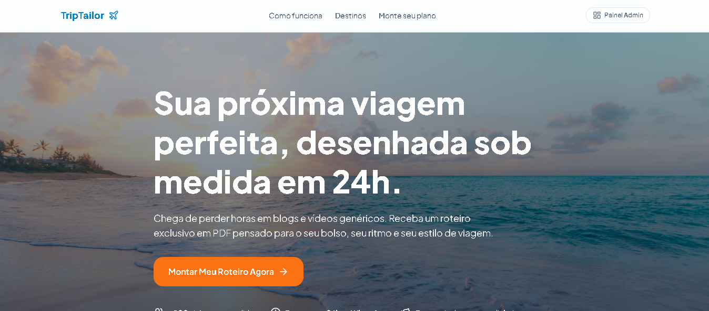
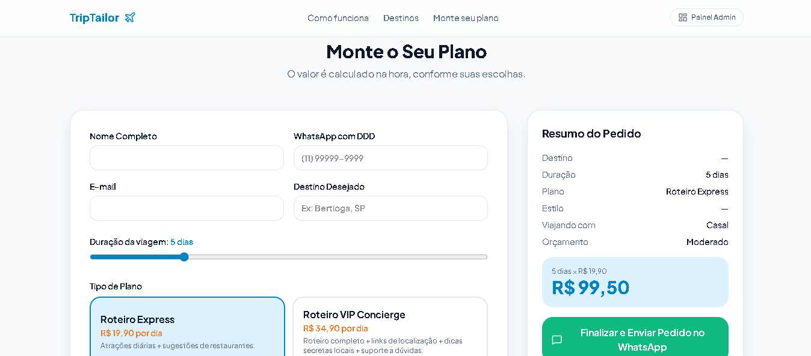
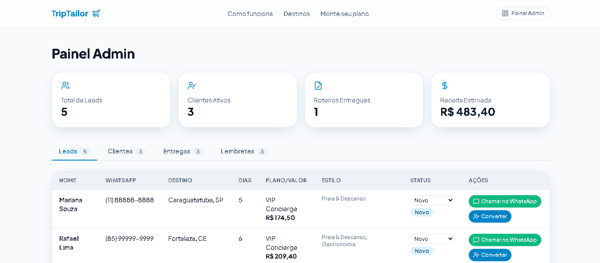

# ✈️ TripTailor — MVP de Curadoria de Roteiros de Viagem Personalizados

> Projeto desenvolvido como parte do desafio prático da **Digital Innovation One (DIO)**: *Da Ideia ao MVP com IA como Co-Founder*.

🔗 **Aplicação Publicada (Live Demo):** [https://triptailor-dio.lovable.app](https://triptailor-dio.lovable.app)  
💻 **Repositório Oficial:** [https://github.com/diegofloriano/triptailor](https://github.com/diegofloriano/triptailor)

---

## 🎯 1. A Dor Escolhida e Por Que Vale um Negócio

Planejar uma viagem por conta própria exige horas de pesquisa em blogs desatualizados, vídeos longos e fóruns espalhados. Por outro lado, pacotes de agências tradicionais são engessados, caros e empurram passeios padronizados que muitas vezes não combinam com o perfil do viajante (quem busca descanso acaba em roteiros corridos, ou quem quer economizar recebe indicações caras).

O **TripTailor** nasce para resolver essa dor: um serviço de curadoria expressa onde o viajante preenche o perfil da sua viagem (destino, dias, estilo, companhia e faixa de orçamento) e recebe, em até 24 horas via WhatsApp, um roteiro personalizado em PDF com passeios, gastronomia e dicas reais adequadas ao seu bolso e ritmo.

---

## 📊 2. Tamanho de Mercado (TAM, SAM, SOM) e Business Model Canvas

### Estimativa de Mercado
* **TAM (Total Addressable Market):** Mercado de turismo doméstico e viagens independentes no Brasil, que movimenta milhões de viagens anuais de lazer e escapadas de fim de semana.
* **SAM (Serviceable Available Market):** Viajantes digitais brasileiros (jovens adultos, casais, famílias e grupos de amigos) que organizam suas próprias passagens e hospedagens (via Airbnb, Booking ou transporte próprio), mas desejam ajuda prática e acessível para montar o cronograma diário do passeio.
* **SOM (Serviceable Obtainable Market):** Nicho inicial focado em viajantes de São Paulo e região Sudeste buscando roteiros otimizados para destinos de alta demanda (Litoral Paulista, Santa Catarina, Nordeste e Serra Gaúcha), captados via redes sociais e tráfego orgânico.

### Business Model Canvas (BMC)

| Bloco | Definição no TripTailor |
| :--- | :--- |
| **Proposta de Valor** | Roteiros de viagem 100% personalizados entregues em até 24h via WhatsApp, economizando horas de pesquisa e evitando armadilhas para turistas. |
| **Segmento de Clientes** | Viajantes independentes (casais, famílias, amigos e viajantes solo) que valorizam experiências autênticas e praticidade sem pagar taxas de agências tradicionais. |
| **Canais** | Landing Page interativa, WhatsApp (fechamento e entrega), Instagram (conteúdo de destinos) e indicação direta. |
| **Relacionamento com Clientes** | Atendimento consultivo e humanizado via WhatsApp + entrega ágil com suporte para dúvidas. |
| **Fontes de Receita** | Cobrança por dia de viagem planejado em dois planos: **Roteiro Express** (R$ 19,90/dia) e **Roteiro VIP Concierge** (R$ 34,90/dia). |
| **Recursos Principais** | Aplicação web (MVP), base curada de destinos/restaurantes, templates de PDF e ferramentas de IA para apoio na estruturação. |
| **Atividades-Chave** | Captação de leads qualificados pelo simulador, fechamento no WhatsApp, curadoria do roteiro e gestão de entregas pelo Painel Admin. |
| **Parcerias Principais** | Criadores de conteúdo de viagem, guias locais, pousadas e restaurantes parceiros. |
| **Estrutura de Custos** | Hospedagem da plataforma (Lovable), ferramentas de design (Canva) e tráfego pago inicial. |

---

## 🧪 3. A Tese do MVP e O Que Ficou Manual de Propósito

### A Tese Validada
> *"Viajantes independentes estão dispostos a preencher um briefing rápido online e pagar um valor acessível por dia de viagem para receber no WhatsApp um roteiro personalizado em 24 horas."*

### O Que o MVP Faz Automaticamente
1. **Landing Page de Alta Conversão:** Apresenta a proposta de valor, benefícios, destinos em destaque e prova social.
2. **Montador de Plano Interativo (Calculadora em Tempo Real):** O cliente escolhe destino, número de dias, modalidade do plano (Express ou VIP), estilo da viagem e orçamento, visualizando o resumo e o preço final na hora.
3. **Integração com WhatsApp (Dados no Corpo da Mensagem):** Ao finalizar, o sistema registra o Lead no banco da aplicação, abre um modal de confirmação e redireciona para o WhatsApp com o pedido estruturado:
   ```text
   Olá, TripTailor! ✈️ Quero meu roteiro:

   - Nome: scoobdoo
   - Destino: Caraguatatuba, SP
   - Dias: 5
   - Plano: Roteiro VIP Concierge
   - Estilo: Praia & Descanso
   - Viajando com: Casal
   - Orçamento: Moderado
   - Obs: amo o mar

   💰 Valor total: R$ 174,50
   ```
4. **Painel de Administração (`/admin`):**
   * **KPIs em Tempo Real:** Total de leads, clientes ativos, roteiros entregues e receita estimada.
   * **Gestão de Leads com Conversão em 1 Clique:** O botão *"Converter em Cliente"* transforma o Lead em Cliente ativo, cria automaticamente a tarefa na aba de **Entregas** e gera o lembrete operacional sem precisar digitar nada novamente.
   * **Controle de Clientes, Entregas (PDF) e Lembretes:** Fluxo operacional completo para acompanhar pagamentos via PIX, disparar mensagens customizadas por status (Pago vs. Pendente) e gerenciar a fila de produção dos roteiros.

### O Que Ficou Manual de Propósito (Concierge MVP)
* **Fechamento e Cobrança (PIX):** O envio da chave PIX é feito na conversa do WhatsApp após confirmar os detalhes com o cliente, evitando custos e fricção de gateway de pagamento antes de validar a demanda inicial.
* **Confecção do Roteiro em PDF:** A montagem final do guia personalizado em PDF e o envio do link acontecem de forma artesanal após a confirmação do pagamento.

---

## 🤖 4. Engenharia de Prompt (Mega Prompt & Correções)

### 4.1. Mega Prompt Inicial Utilizado no Lovable

```text
Construa uma aplicação web completa, moderna e responsiva para o TripTailor, um serviço de assinatura e criação de roteiros de viagem sob medida entregues em até 24 horas.

Regras:
1. Não gere imagens com IA. Utilize URLs públicas do Unsplash e ícones lucide-react.
2. Utilize persistência de dados populando o sistema com mock data realistas em todas as abas do Admin.
3. Interface 100% em Português (Brasil).

Identidade Visual:
- Cor Primária (Azul Oceano): #0284C7
- Cor Secundária / CTA (Coral Pôr do Sol): #F97316
- Cor WhatsApp (Verde Esmeralda): #10B981

Estrutura:
1. Fluxo do Cliente (Landing Page):
   - Hero Section com CTA para o montador de roteiro.
   - Seção Como Funciona em 3 passos e Destinos em Alta (Litoral Norte SP, Fortaleza, Balneário Camboriú).
   - Formulário Interativo "Monte o Seu Plano" com cálculo de preço em tempo real (Roteiro Express R$ 19,90/dia e Roteiro VIP Concierge R$ 34,90/dia), salvamento automático na aba Leads e envio dos dados preenchidos para o WhatsApp.
2. Painel de Administração (/admin):
   - KPIs no topo (Leads, Clientes, Roteiros Entregues, Receita).
   - Aba Leads com conversão em 1 clique para Cliente + Entrega + Lembrete.
   - Aba Clientes (controle de status de pagamento PIX).
   - Aba Entregas (status de produção do PDF e envio no WhatsApp).
   - Aba Lembretes e Tarefas operacionais.
```

### 4.2. Testes Realizados e Prompt de Correção Aplicado

Durante os testes práticos do MVP como cliente e administrador:
* **O que funcionou de primeira:** A calculadora do formulário na Landing Page, o salvamento de novos leads e o fluxo do Painel Admin (incluindo a conversão automática do Lead para a aba de Clientes).
* **O que exigiu ajuste e validação:** Ao clicar nos botões do WhatsApp dentro do editor do Lovable, o navegador retornava `ERR_BLOCKED_BY_RESPONSE`, pois a API do WhatsApp bloqueia abertura dentro de *iframes* de pré-visualização. Implementamos um Modal intermediário com pré-visualização da mensagem, botão de cópia rápida, botão de WhatsApp na aba de Clientes com texto dinâmico por status de pagamento e redirecionamento externo. No teste em ambiente publicado (`triptailor-dio.lovable.app`), fora do *sandbox* do editor, o redirecionamento para o aplicativo do WhatsApp funcionou perfeitamente.

**Prompt Único de Correção Aplicado:**
```text
Corrija todos os botões e ações de redirecionamento para o WhatsApp na Landing Page e no Painel Admin seguindo estas regras:
1. Sempre que o usuário clicar em qualquer botão de WhatsApp, abra um Modal (Dialog) na tela exibindo a pré-visualização da mensagem formatada com os dados do pedido.
2. Adicione no Modal um botão "Copiar Mensagem" (com feedback visual) e botões para abrir no WhatsApp (wa.me) ou WhatsApp Web em uma nova aba externa, evitando o bloqueio ERR_BLOCKED_BY_RESPONSE em iframes, além de incluir o botão "Chamar no WhatsApp" na aba Clientes adaptando a mensagem conforme o status do pagamento (Pago ou Aguardando PIX).
3. Garanta que o Lead seja salvo imediatamente como "Novo" no Painel Admin antes de abrir o Modal.
```

---

## 🌐 5. Acesso à Aplicação Publicada

* **Landing Page e Simulador de Planos:** [https://triptailor-dio.lovable.app](https://triptailor-dio.lovable.app)

  




* **Painel Administrativo (Leads, Clientes, Entregas e Lembretes):** Acessível pelo botão **Painel Admin** no menu superior da aplicação.

  

---

## 🚀 Como Executar o Projeto Localmente

```bash
# 1. Clone este repositório
git clone [https://github.com/diegofloriano/triptailor.git](https://github.com/diegofloriano/triptailor.git)

# 2. Acesse a pasta do projeto
cd triptailor

# 3. Instale as dependências
npm install

# 4. Inicie o servidor de desenvolvimento
npm run dev
```

---

## 👨‍💻 Autor

Desenvolvido por **Diego Floriano Costa** como projeto prático da **Digital Innovation One (DIO)**.

* **GitHub:** [@diegofloriano](https://github.com/diegofloriano)
